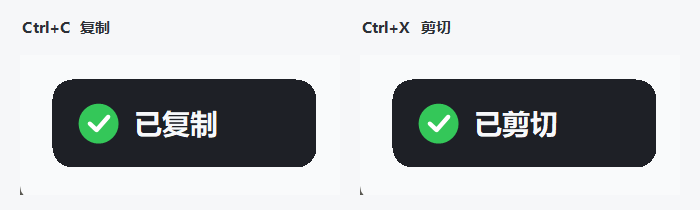

# ClipAck

> 复制或剪切后，在屏幕左下角给你一个干净利落的确认。

ClipAck 是一个面向 Windows 10 / Windows 11 的轻量托盘工具。按下 **Ctrl+C** 或 **Ctrl+X** 后，它会在屏幕左下角显示 **“已复制”** 或 **“已剪切”**，1 秒后自动消失。

它没有主窗口，不会打断你的操作，也不读取、不上传剪贴板里的文字、图片或文件内容。



## 功能

- **Ctrl+C → 已复制**
- **Ctrl+X → 已剪切**
- 支持文本、图片、聊天记录、文件等会更新 Windows 剪贴板的内容
- 资源管理器中右键“复制 / 剪切”文件也能准确区分
- 纯托盘运行，没有固定窗口
- 提示 1 秒后自动消失
- 提示框不抢焦点、不阻挡鼠标
- 开机自启，无需管理员权限
- 单实例运行，不会重复弹窗
- 右键托盘图标 → **“关闭复制反馈”**，退出并移除开机自启

## 关于 Ctrl+V

**Ctrl+V 是粘贴，不是剪切。** 粘贴只是读取剪贴板，并不会更新剪贴板，因此 ClipAck 不会在 Ctrl+V 时弹出提示。

真正的剪切快捷键是 **Ctrl+X**。

| 快捷键 | 动作 | ClipAck 提示 |
| --- | --- | --- |
| Ctrl+C | 复制 | 已复制 |
| Ctrl+X | 剪切 | 已剪切 |
| Ctrl+V | 粘贴 | 不提示 |

## 系统要求

| 项目 | 要求 |
| --- | --- |
| 操作系统 | Windows 10 1607 及以上 / Windows 11 |
| 运行环境 | .NET Framework 4.x（Windows 10/11 自带） |
| 权限 | 普通用户权限，无需管理员 |
| 测试环境 | Windows 11 64 位 |

## 下载与运行

1. 下载仓库中的 [release/ClipAck.exe](release/ClipAck.exe)。
2. 如果拿到的是压缩包，请先解压。
3. 双击 `ClipAck.exe`。

首次运行时，ClipAck 会：

- 把自己复制到 `%LOCALAPPDATA%\ClipAck\ClipAck.exe`
- 写入当前用户的开机自启项
- 在系统托盘启动

不需要安装向导，也不会弹出 UAC 提权窗口。

> 托盘图标被 Windows 11 折叠时，点击任务栏右下角的 `^` 展开隐藏图标即可看到。

> 由于程序没有代码签名，通过浏览器或聊天软件接收后，Windows SmartScreen 可能提示“Windows 已保护你的电脑”。点击 **更多信息 → 仍要运行** 即可。

## 使用

正常复制或剪切内容即可，屏幕左下角会出现提示。

要关闭 ClipAck：

1. 右键点击托盘中的 ClipAck 图标。
2. 点击 **“关闭复制反馈”**。

程序退出后会同步移除开机自启项，之后不会再自动启动。想重新启用时，再次双击 `ClipAck.exe` 即可。

## 卸载

1. 右键托盘图标，点击 **“关闭复制反馈”**。
2. 删除目录 `%LOCALAPPDATA%\ClipAck`。

如果不需要保留任何设置，还可以检查注册表启动项：

```text
HKEY_CURRENT_USER\Software\Microsoft\Windows\CurrentVersion\Run
```

删除名为 `ClipAck` 的值即可。

## 从源码构建

项目只有一个 C# 源文件，使用 Windows 自带的 .NET Framework 编译器即可构建，不需要安装 Visual Studio。

双击 `build.bat`，生成结果位于：

```text
build\ClipAck.exe
```

`build.bat` 会自动在系统中查找 .NET Framework 4.x 的 `csc.exe`，并使用以下资源编译：

- `ClipAck.cs`
- `ClipAck.ico`

也可以手动执行编译命令（请在仓库根目录下运行）：

```bat
if not exist build mkdir build
%WINDIR%\Microsoft.NET\Framework64\v4.0.30319\csc.exe ^
  /target:winexe /platform:anycpu /optimize+ /codepage:65001 ^
  /win32icon:ClipAck.ico ^
  /out:build\ClipAck.exe ^
  /r:System.Windows.Forms.dll /r:System.Drawing.dll ^
  ClipAck.cs
```

## 工作原理

ClipAck 的核心逻辑都集中在 `ClipAck.cs`：

1. 使用 `AddClipboardFormatListener` 监听 `WM_CLIPBOARDUPDATE`，只在剪贴板真正发生变化时触发提示。
2. 使用低级键盘钩子观察 **Ctrl+C / Ctrl+X**，为紧随其后的剪贴板更新标记“复制”或“剪切”。
3. 在资源管理器中，通过 `Preferred DropEffect` 标志识别文件右键菜单的“剪切 / 复制”。
4. 用一个无边框、无激活、鼠标穿透的置顶窗口显示提示，1 秒后自动隐藏。

整个过程不会把文本、图片或文件内容写入磁盘，也不会联网。

## 已知限制

- **右键菜单剪切文本**：Windows 剪贴板不提供“这段文字是复制还是剪切”的标准标记，因此这种情况会默认显示“已复制”。使用 Ctrl+X 或剪切文件不受影响。
- **Ctrl+V 不提示**：粘贴不会修改剪贴板，这是预期行为。
- 少数应用使用私有方式处理复制/剪切，可能不会触发标准剪贴板更新。
- 全局键盘钩子可能被部分安全软件拦截。此时复制提示仍能工作，但无法区分文本的复制和剪切。
- 目前只在 Windows 11 64 位上完成实测，Windows 10 兼容性基于所用系统 API。

## 安全与隐私

- 不联网，无遥测，无自动更新。
- 不保存剪贴板内容。
- 键盘钩子只判断 Ctrl 与 C/X 的组合，不记录、不上传其他按键。
- 首次运行会复制自身并写入当前用户的开机启动项，因此个别安全软件可能敏感误报；这是程序实现托盘常驻和开机自启所必需的。

## 项目结构

```text
ClipAck/
├─ ClipAck.cs          # 全部程序逻辑
├─ ClipAck.ico         # 应用与托盘图标
├─ build.bat           # 一键构建脚本
├─ .gitignore          # 忽略本地构建产物
├─ release/
│  └─ ClipAck.exe      # 已编译版本
├─ preview.png         # 效果预览图
└─ README.md
```

## 作者

**Cun Zhang**

## 许可证

本项目暂未指定开源许可证。如需正式开源发布，建议补充 MIT License，版权人写为 **Cun Zhang**。
